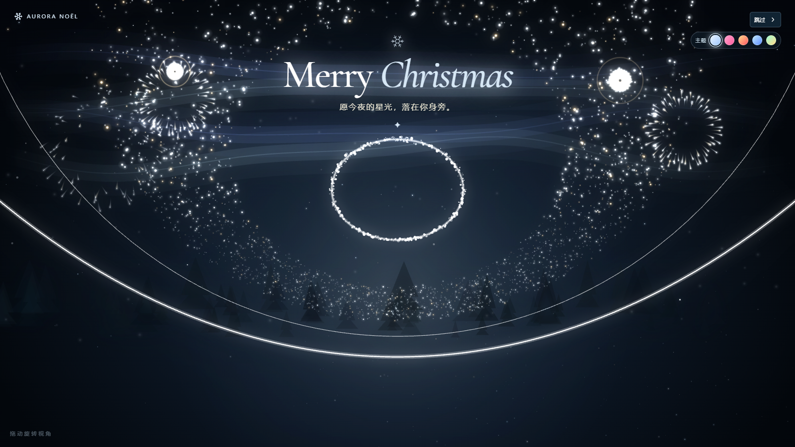
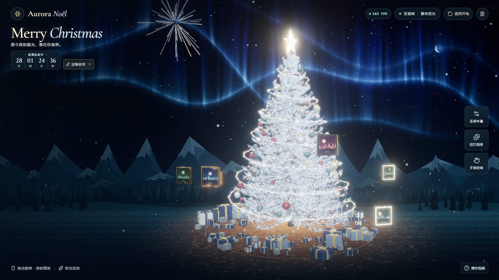

# Aurora Noël · 极光圣诞树（120fps 增强版）

在极光、雪山与星雪之间，点亮一棵可以互动的 3D 圣诞树。开场是一枚白色光点自下而上画出螺旋线圈，镜头跟着它转动；随后它炸成一个立体环层，粒子保持同一高度在三维空间里向外扩散，圆环本身始终保留；扩散完的粒子再散成圣诞树的轮廓，光点重新从树底画线亮灯，到顶后星芒亮起、头顶粒子环绽放。背景是带视差的三维星空与多层松林，夜空烟花先炸成完整的圆，再由重力、阻力和湍流拉成丝线。进入主场景后仍是同一套月光银配色。

> 本项目基于 MIT 开源的 [Aurora Noël](https://github.com/nobody-r/christmas-tree) 做了增强：慢速环绕的光点开场、月光银主题与自定义颜色、带物理丝线的夜空烟花与频率选项、内置本地音乐、实时 FPS、画质档位与自适应分辨率、可移植字体路径、全离线资源，并针对 120fps 做了优化。






## 功能

- **3D 环层开场**：光点沿 12 圈螺旋画到树尖才炸开 → 强光 + 冲击波环 → 立体环层（环保留）→ 粒子固定高度在 xy 平面扩散 → 散成树轮廓 → 光点画线亮灯 → 到顶亮星；结尾的树顶粒子圆环保留；背景为视差星空与多层松林
- **重播开场**：右上角「返回开场」按钮或按 `R`，随时回到开头重新看一遍动画
- **进入按钮与任意角度查看**：开场结束只显示「进入主界面」按钮，点击按钮才跳转主场景；开场期间按住画面拖动可 360° 旋转、上下俯仰到任意角度，滚轮或双指捏合缩放，松手后有惯性滑行
- **主题色**：月光银（默认）、玫瑰粉、经典金、冰蓝、极光绿，也支持任意自定义颜色
- **夜空烟花**：关闭 / 舒缓 / 常态 / 热闹四档频率；先炸开成完整花形，再受重力、空气阻力和湍流驱动落下成丝线
- **流星**：夜空中不定时划过带渐隐丝带拖尾、亮头与飘散星屑的流星，滑落角度平缓，横跨夜空
- **单文件分享**：`npm run build:share` 生成约 9 MB 的 `share/index.html`；视觉、三首内置音乐、相册和主题都可用，摄像头手势需要完整部署包
- **Three.js 实时场景**：极光天空、雪山、雪地、飘雪、粒子星尘、辉光后期
- **圣诞树 / 星光漂浮** 两种展示模式
- **圣诞布置**：粒子数量、主色、点缀色、礼盒与彩球数量、三种画质模式
- **回忆相册**：照片保存在浏览器 IndexedDB，以 3D 金属相框出现在树旁
- **手势控制**：MediaPipe Hands 最多同时追踪两只手；食指移动光标，张开手掌的状态下捏合食指和拇指会随机打开一张照片、松开放回，张开手掌绽放星光、握拳暂停
- **内置音乐**：Biscuit and Tea → Mismatch → Silent Night，默认从第一首开始，支持多选上传与自动轮播
- **音乐律动**：音频频谱驱动灯光与粒子；内置 Biscuit and Tea、Mismatch、Silent Night 三首，也支持一次上传多首本地音乐并自动轮播
- **本地播放列表**：可多选上传、点任意一首播放、上一首/下一首、移除本地曲目；一首播完自动切下一首
- **圣诞倒计时与名字定制**：名字会写入主场景祝福，并在当前浏览器记住
- **实时 FPS 与自适应画质**：右上角显示真实帧率，智能模式自动增减渲染分辨率
- **手机轻量模式**：移动端自动进入 lite（更少粒子、关闭后期泛光、开场固定 30fps、DPR 上限 1.25）；想强制完整画质可在网址后加 `?full`，想强制轻量可加 `?lite`
- **全离线**：字体、音乐、手势模型全部在本地，构建后不再依赖任何 CDN

## 快速开始

需要 Node.js 22.12+：

```sh
npm install
npm run dev
```

打开终端显示的地址即可。`npm install` 时如果看到 npm 11 的 `allow-scripts` 提示，不影响运行（esbuild 的平台二进制会由 optional dependency 安装）。

生产构建：

```sh
npm run build
npm run preview
```

产物在 `dist/`，可以直接部署到 Netlify、Cloudflare Pages、Vercel、GitHub Pages 或自己的静态服务器。

## 单文件分享版

```sh
npm run build:share
```

会生成 **`share/index.html`**，约 9 MB：JS、CSS、字体和三首内置音乐都内联在一个 HTML 里，可以直接发文件、双击打开或放到任意静态目录，不需要带其它资源。视觉、主题、烟花、音乐播放列表和相册上传都能用。

单文件版不内联 MediaPipe 手势模型（约 23 MB），所以隐藏了摄像头手势按钮；需要手势时请部署 `dist/` 并通过 HTTPS/localhost 打开。

## 开场与主题

开场是一条 3D 时间轴，不是贴图或视频：

1. 白色光点自下而上沿 12 圈三维螺旋（和树身的 13 圈螺旋同一条路径）一路画到树尖，镜头跟着光点改变 yaw/pitch，视差星空与多层松林随透视移动。
2. 光点画到树尖才炸开：先是一团强光，接着冲击波环在同一高度快速扩大，一路扩散到整个屏幕；随后出现有厚度的三维环层，圆环本体保留，粒子固定 z 轴高度、只在 xy 平面里向外扩散到全屏。
3. 粒子扩散完后散向锥形树坐标，形成树的粗略轮廓；扩散期间圆环一直保留，直到树体亮起后才逐渐隐去。
4. 新的光点从树底开始沿 13 圈螺旋画线亮灯，灯串、彩球、星尘和金色散景逐圈出现。
5. 光点到达树顶后星芒才亮起；随后头顶绽放一个粒子圆环，圆环在同一平面扩大并散落，结尾的树顶圆环会一直保留。全程相机继续缓慢环绕。

进入主场景后，右上角的 **「返回开场」** 按钮或键盘 **R** 会回到开头重新播放整段动画。

主题选择：

- **月光银（默认）**：银白针叶、冰蓝极光、月光色界面
- **玫瑰粉**：粉色针叶、玫红极光、玫瑰金界面
- **经典金**：绿色冷杉、金色灯串与极光
- **冰蓝**：蓝白针叶与蓝紫极光
- **极光绿**：青绿极光与暖金点缀
- **自定义**：设置 →「主题色」里的颜色选择器，会从任意主色推导出配套的极光、灯光、树色和界面强调色

主题会同时作用于开场动画、圣诞树的针叶/星星/灯串、天空极光、场景灯光和界面强调色；开场右上角可以先试色，进入后也能在「圣诞布置」里随时切换。

## 夜空烟花

- 打开「圣诞布置」→「夜空烟花」，可选 **关闭 / 舒缓 / 常态 / 热闹**（分别约 12 / 7 / 4 秒一簇，关闭为 0）。
- 每一簇会炸出 48 条独立丝线：前 0.55 秒先让它们均匀铺开成一朵完整的花，之后再逐渐加重力、空气阻力、切向旋涡和湍流，头部与 42 个历史采样点连成面向相机的细丝带，于是花朵先成形，再弯曲、下垂、飘散。
- 烟花颜色跟随主题，带辉光；频率越高越热闹，关闭后树和星光效果保持不变。
- 烟花由独立的 Three.js 几何体渲染，和树上的星光、手势绽放互不影响；夜空还会不定时出现带尾迹的流星。

## 120fps 与画质

- 右上角的 **FPS** 是实际渲染帧率；鼠标悬停可看到目标、渲染倍率和屏幕刷新率。
- **智能**（默认）：从 1.0× 开始，连续掉帧时自动降到最低 0.6×，帧率富余时再升回去。
- **高帧率**：固定约 0.82× 分辨率，优先跑满高刷屏。
- **画质优先**：最高 1.45× 分辨率，画面更锐利，帧率可能下降。
- 在 1600×900、RTX 5060 Laptop 上实测 **120 FPS 以上**（月光银主题，120Hz 屏幕满帧；关闭 vsync 的吞吐测试可达 240 FPS）；正常浏览器会按屏幕刷新率封顶，**120Hz 屏幕可跑满 120**。
- 想进一步压榨帧率：在设置里选「高帧率」，并降低「粒子数量」「礼物盒数量」「彩球数量」。`?lite` 参数可关闭辉光并减少粒子。

## 音乐

- 内置播放列表顺序：**Biscuit and Tea · Gabriella Lin** → **Mismatch · Gabriella Lin** → **Silent Night · Music Box**，默认从第一首开始，播完自动切下一首，最后一首之后循环回第一首。
- 三首内置曲目不依赖外链；设置 →「圣诞音乐」可播放/暂停、上传本地音频；上传按钮支持**一次多选**，文件会加入「播放列表」。本地曲目排在末尾。
- 播放列表包含内置曲目和本地曲目：可以点任意一首播放，也可以上一首/下一首；一首播完会自动切到下一首，到末尾后循环回第一首。
- 本地曲目右侧的垃圾桶可以从列表移除；三首内置曲目固定保留。
- 音乐频谱会实时驱动灯串与粒子的亮度。上传的音频只存在于当前页面会话，不会上传到服务器。

## 手势

1. 点右侧「手势控制」，允许摄像头。
2. 手掌进入画面后，按下面的映射操作；摄像头预览下方也有一行速查，点右下角「操作指南」可看完整说明。

| 手势 | 功能 |
| --- | --- |
| 食指移动 | 光标跟随食指；出现两只手时优先跟随正在捏合的那只 |
| 张开手掌 + 拇指食指捏合 | 随机打开一张照片；松开捏合后照片回原位，约 0.8 秒冷却，星光不会收回 |
| 张开手掌 | 星光绽放，树、礼物和彩球散成星光 |
| 握拳 | 暂停手势光标，避免误触 |

手势模式最多同时追踪两只手。捏合只认「拇指+食指伸出相碰、其余三指仍张开」的形状：间距阈值收紧、跨帧平滑并加长确认时间（140ms），避免普通手部动作被误判成捏合；张开手掌时捏合不会再被当成握拳而收回星光。相册照片也可以用鼠标点一下打开，再点空白处关闭，不需要鼠标一直跟随。保持手在画面里、光线充足，手掌距离摄像头约 30–80cm。摄像头需要 HTTPS 或 localhost。视频帧只在浏览器本地由 MediaPipe 处理，不会上传。手势模型与 wasm 已放在 `public/mediapipe/hands/`，构建后无需联网。

## 部署

`vite.config.js` 使用 `base: './'`，字体、音乐、手势资源都按相对路径加载，因此部署在域名根目录或 GitHub Pages 子路径都可以：

- **Netlify / Cloudflare Pages**：把 `dist/` 拖进上传页即可。
- **GitHub Pages**：把 `dist/` 内容推到仓库的 `gh-pages` 分支，或在 Pages 设置里选择该目录。
- **自己的服务器**：把 `dist/` 放到任意静态目录。

## 自定义

- 主题色：`src/theme.js` 的 `THEMES`，或直接用界面里的「自定义主题色」
- 开场动画：`src/intro.jsx`（光点画线、慢速环绕、粒子拖尾、爆散骨架、由下往上亮灯、顶部光环）
- 初始粒子/礼盒/彩球数量与颜色：`src/main.jsx` 的 `initialSettings`
- 默认相册：`src/data.js` 的 `defaultPhotos()` 与 `palettes`
- 圣诞树造型：`src/tree.js` 的 `startY`、`height`、`radius`、`widthAt()`
- 极光/雪山：`src/sky.js` 的 `skyFragment` 与 `drawTerrain()`
- 画质策略：`src/scene.js` 的 `ratioCeiling()`、`adaptQuality()`
- 音乐：内置曲目在 `public/audio/`，顺序和标题在 `src/sound.js` 的 `builtInTracks` 里；上传的本地曲目只保存在当前会话

## 目录

```
src/
  main.jsx       界面、设置、相册、名字、音乐
  theme.js       主题色板与自定义颜色推导
  intro.jsx      光点画线（慢速环绕）→ 爆散骨架 → 亮灯 → 亮星 + 粒子光环
  scene.js       Three.js 场景、画质、FPS
  tree.js        圣诞树、彩球、礼盒、粒子爆发
  sky.js         极光 shader + 雪山/雪地绘制
  gallery.js     金属相框与相册交互
  hand.jsx       摄像头预览与手势 UI
  hand-gesture.js 手势判定
  sound.js       音乐播放列表、自动轮播与频谱
  fireworks.js   先开花后落下的物理丝线烟花
  meteors.js     夜空流星与尾迹
  styles.css     界面样式
vite.config.js 常规构建配置
vite.share.config.js 单文件分享版构建配置
scripts/build-share.mjs 生成 share/index.html
public/
  audio/         内置音乐
  mediapipe/     本地手势模型
  fonts/         字体许可文件
share/index.html 单文件分享版（约 9 MB）
docs/preview.png      主场景预览
docs/preview-intro.png 开场预览
```

## 许可与致谢

- 原始项目：**Aurora Noël**，MIT License，Copyright (c) 2026 wdaaaa
- 本增强版同样以 MIT License 分发，详见 [LICENSE](LICENSE)
- Cormorant Garamond 与 Noto Serif SC 按 SIL Open Font License 分发
- 手势识别使用 [MediaPipe Hands](https://developers.google.com/mediapipe)（Apache-2.0）
- 内置音乐：《Silent Night》八音盒编曲，以及用户提供的 Gabriella Lin《Biscuit and Tea》《Mismatch》；顺序为 Biscuit and Tea → Mismatch → Silent Night
